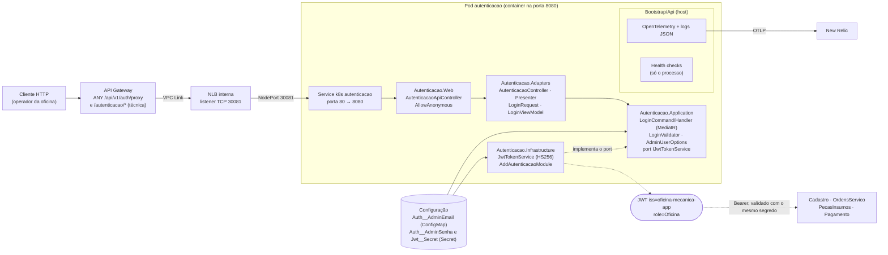

# oficina-mecanica-autenticacao

Microsserviço **Autenticação** do sistema de oficina mecânica — Tech Challenge da pós-graduação em
Arquitetura de Software (FIAP/SOAT), **Fase 4**.

Emite o **JWT (HS256) do papel `Oficina`** aceito por todos os serviços do sistema. É um serviço
**sem banco de dados**: o login da oficina é **simulado** — existe uma única credencial de
administrador, vinda de configuração (e-mail) e de secret (senha). Foi extraído do módulo
`Autenticacao` do monólito original e mantém Clean Architecture
(`Application` → `Adapters` → `Infrastructure`/`Web`), com o host em `src/Bootstrap/Api`.

## Índice

- [Propósito e responsabilidade](#propósito-e-responsabilidade)
- [Arquitetura do serviço](#arquitetura-do-serviço)
- [Tecnologias](#tecnologias)
- [Pré-requisitos](#pré-requisitos)
- [Execução local](#execução-local)
- [Configuração](#configuração)
- [API](#api)
- [O token emitido e a relação com a Lambda](#o-token-emitido-e-a-relação-com-a-lambda)
- [Testes e cobertura](#testes-e-cobertura)
- [Pipeline de CI/CD](#pipeline-de-cicd)
- [Deploy no EKS e limitação da AWS Academy](#deploy-no-eks-e-limitação-da-aws-academy)
- [Observabilidade](#observabilidade)
- [Limitações conhecidas](#limitações-conhecidas)
- [Repositórios do sistema](#repositórios-do-sistema)

---

## Propósito e responsabilidade

- Autenticar o **administrador da oficina** (`POST /api/v1/auth/login`) e devolver um JWT com
  `role = Oficina`, válido por 1 hora.
- Ser o **único serviço que emite o token da oficina**. Os demais serviços (OrdensServico, Cadastro,
  PecasInsumos, Pagamento) apenas **validam** o token, com o mesmo segredo e a mesma audience.
- **Não** emite o token do cliente: esse é emitido pela Lambda de autenticação por CPF
  (`oficina-mecanica-lambda-auth`), com `role = Cliente`.

O serviço **não tem banco, não publica nem consome eventos** e não chama nenhum outro serviço — ele só
conhece a configuração. Não depende de PostgreSQL, SQS/SNS nem do LocalStack.

## Arquitetura do serviço



A **Regra de Dependência** é forçada por referências de projeto: `Application` referencia só o
`SharedKernel.Application`, `Adapters` referencia `Application`, `Web` referencia `Adapters` e
`Infrastructure` referencia os anteriores. `Application` não conhece ASP.NET nem a biblioteca de JWT;
ela define o *port* `IJwtTokenService` e o `LoginHandler` valida a credencial contra
`AdminUserOptions` (seção `Auth` da configuração). A assinatura do token fica em `Infrastructure`
(`JwtTokenService`).

| Camada | Projeto | Conteúdo |
|---|---|---|
| Application | `Autenticacao.Application` | `LoginCommand`, `LoginHandler`, `LoginValidator`, `AutenticacaoErrors`, `AdminUserOptions`, port `IJwtTokenService` |
| Adapters | `Autenticacao.Adapters` | `AutenticacaoController` (Clean Architecture), `AutenticacaoPresenter`, `LoginRequest`, `LoginViewModel` |
| Infrastructure | `Autenticacao.Infrastructure` | `JwtTokenService` (HS256) e `AddAutenticacaoModule` |
| Web | `Autenticacao.Web` | `AutenticacaoApiController` (`[AllowAnonymous]`), que traduz o `Result` em status HTTP |
| Host | `src/Bootstrap/Api` | `Program.cs`, configuração do JWT Bearer, OpenAPI/Scalar, health checks, observabilidade |
| SharedKernel | `src/SharedKernel` | `Result`, `Error`, behaviors do MediatR e demais tipos compartilhados (cópia do monólito) |

Não há camada `Domain`: o serviço não possui agregados nem estado.

## Tecnologias

| Tecnologia | Uso |
|---|---|
| .NET 10 / ASP.NET Core | API REST em controllers |
| MediatR 12 + FluentValidation 11 | Caso de uso de login e validação de entrada |
| `System.IdentityModel.Tokens.Jwt` | Emissão do JWT HS256 |
| JWT Bearer (HS256) | Configuração de validação compartilhada com os demais serviços |
| OpenAPI nativo + Scalar | Contrato (`/openapi/v1.json`) e UI interativa (`/scalar`) |
| OpenTelemetry (OTLP) | Traces, métricas e logs → New Relic (Jaeger local) |
| xUnit v3, Moq | Testes unitários e de integração (`WebApplicationFactory`, sem Docker) |
| Docker, Kubernetes (EKS), GitHub Actions | Empacotamento, deploy e pipelines |

## Pré-requisitos

- .NET SDK 10 e Docker (Compose v2).
- O repositório [`oficina-mecanica-app`](https://github.com/gabrielMauad/oficina-mecanica-app)
  clonado: é ele quem mantém o `docker-compose.infra.yml` (rede Docker `oficina-local` e Jaeger).

## Execução local

```bash
# 1. no repositório oficina-mecanica-app: cria a rede oficina-local e sobe LocalStack + Jaeger
docker compose -f docker-compose.infra.yml up -d

# 2. neste repositório
docker compose up --build
```

| Item | Valor |
|---|---|
| API | <http://localhost:8081> (a raiz redireciona para o Scalar em `/scalar`) |
| OpenAPI | <http://localhost:8081/openapi/v1.json> |
| Jaeger | <http://localhost:16686> |

```bash
curl -X POST http://localhost:8081/api/v1/auth/login \
  -H "Content-Type: application/json" \
  -d '{"email":"admin@oficina.com","senha":"admin123"}'
```

Resposta (200): `{ "token": "<jwt>", "expiresAt": "2026-01-01T13:00:00Z" }`. Use o token como
`Authorization: Bearer <jwt>` nos outros serviços locais (todos com o mesmo `Jwt__Secret`). O arquivo
[`src/Bootstrap/Api/Api.http`](src/Bootstrap/Api/Api.http) traz a requisição pronta.

## Configuração

Variáveis de ambiente (a notação `__` é o separador de seção do .NET):

| Chave | Obrigatória | Valor local (compose) | No Kubernetes |
|---|---|---|---|
| `Jwt__Secret` | sim | `docker-dev-secret-key-replace-in-prod-000` | Secret `autenticacao-secrets` (chave `jwt_secret` do segredo `oficina-mecanica/dev/app`) |
| `Jwt__Issuer` | sim | `oficina-mecanica-app` | ConfigMap `autenticacao-config` |
| `Jwt__Audience` | sim | `oficina-mecanica-api` | ConfigMap |
| `Jwt__ValidIssuers__0` / `__1` | sim | `oficina-mecanica-app` / `oficina-mecanica-auth` | ConfigMap |
| `Auth__AdminEmail` | sim | `admin@oficina.com` | ConfigMap (o e-mail não é sensível) |
| `Auth__AdminSenha` | sim | `admin123` | Secret `autenticacao-secrets` (chave `admin_senha` do segredo `oficina-mecanica/dev/app`) |
| `OpenApi__Enabled` | não (padrão `true`) | `true` | ConfigMap |
| `OTEL_SERVICE_NAME` | não | `oficina-mecanica-autenticacao` | ConfigMap |
| `OTEL_EXPORTER_OTLP_ENDPOINT` | não | `http://oficina-jaeger:4317` | ConfigMap (`https://otlp.nr-data.net:4318`, `http/protobuf`) |
| `OTEL_EXPORTER_OTLP_HEADERS` | só na nuvem | — | Secret (`api-key=<license key do New Relic>`) |

Sem `Jwt__Secret`, `Jwt__Issuer` ou `Jwt__Audience`, a emissão e a validação do token lançam
`InvalidOperationException` ("JWT secret não configurado" e equivalentes). `Jwt__ValidIssuers__*`
serve à configuração de validação do host, igual à dos demais serviços. Os valores de
desenvolvimento acima são **locais** — na nuvem, segredo e senha vêm do AWS Secrets Manager.

## API

| Método | Rota | Papel | Descrição |
|---|---|---|---|
| `POST` | `/api/v1/auth/login` | anônima | Corpo `{ "email", "senha" }`. **200** com `{ "token", "expiresAt" }`; **401** se a credencial for inválida |

Regras do login:

- O e-mail é comparado **sem diferenciar maiúsculas de minúsculas** com `Auth__AdminEmail`; a senha é
  comparada por igualdade exata com `Auth__AdminSenha`.
- Qualquer falha devolve **401** com `{ "code", "message" }`: credencial incorreta
  (`Autenticacao.CredenciaisInvalidas`) **e** corpo inválido (e-mail vazio ou mal formatado, senha
  vazia), porque o controller web traduz toda falha do caso de uso em 401.
- O token carrega sempre `role = Oficina` — este serviço não emite outro papel.

### Rotas técnicas (sem autenticação)

| Rota | Descrição |
|---|---|
| `GET /healthz/live` | Liveness: o processo está de pé |
| `GET /healthz/ready` | Readiness: reflete **apenas o processo** (o serviço não tem dependências externas) |
| `GET /healthz` | Agrega todos os checks |
| `GET /openapi/v1.json` | Documento OpenAPI |
| `GET /scalar` | UI interativa (Scalar) |

### OpenAPI / Swagger

O contrato é publicado em OpenAPI (a entrega equivalente ao Swagger): localmente em
`http://localhost:8081/openapi/v1.json` e `http://localhost:8081/scalar`. Na nuvem, pelo API Gateway,
na rota técnica com reescrita de caminho:

```bash
API_URL=$(aws apigatewayv2 get-apis \
  --query "Items[?Name=='oficina-mecanica-api'].ApiEndpoint | [0]" --output text)

curl "$API_URL/autenticacao/openapi/v1.json"
curl "$API_URL/autenticacao/healthz/ready"
```

`GET /autenticacao/healthz/ready` chega ao pod como `GET /healthz/ready`. No API Gateway, a rota de
negócio deste serviço é `ANY /api/v1/auth/{proxy+}`:

```bash
curl -X POST "$API_URL/api/v1/auth/login" -H "Content-Type: application/json" \
  -d '{"email":"admin@oficina.com","senha":"<senha do admin>"}'
```

A coleção de requisições do sistema inteiro fica no repositório
[`oficina-mecanica-app`](https://github.com/gabrielMauad/oficina-mecanica-app/blob/main/docs/guias/collection_bruno.yml).

## O token emitido e a relação com a Lambda

O sistema tem **dois emissores** de token, que assinam com o mesmo segredo HS256 e a mesma audience
([ADR-001](https://github.com/gabrielMauad/oficina-mecanica-app/blob/main/docs/arquitetura/adrs/001-jwt-hs256-segredo-compartilhado.md),
[ADR-003](https://github.com/gabrielMauad/oficina-mecanica-app/blob/main/docs/arquitetura/adrs/003-dois-emissores-e-autorizacao-por-papel.md)):

| | Este serviço | Lambda de autenticação por CPF |
|---|---|---|
| Rota | `POST /api/v1/auth/login` | `POST /auth/cpf` (pelo API Gateway) |
| Credencial | e-mail + senha do administrador | CPF de um cliente cadastrado e ativo |
| `iss` | `oficina-mecanica-app` (`Jwt__Issuer`) | `oficina-mecanica-auth` |
| `aud` | `oficina-mecanica-api` | `oficina-mecanica-api` |
| `sub` | o e-mail informado no login | o `id` do cliente |
| `role` | `Oficina` | `Cliente` (além da claim `cpf`) |
| Validade | 1 hora | 1 hora |

Os serviços validam assinatura, audience e emissor (`ValidIssuers` aceita os dois `iss` acima), leem o
papel da claim `role` e o sujeito da claim `sub` (sem remapeamento de claims, `ClockSkew` zero). A
autorização é por papel: rotas da oficina exigem `Oficina`; rotas do cliente (`Cliente`) ainda checam
que o `sub` é o dono do recurso (senão, 403).

Para identificar o cliente, a Lambda **consulta o serviço
[Cadastro](https://github.com/gabrielMauad/oficina-mecanica-cadastro)** (`GET /api/v1/clientes/documento/{cpf}`
direto na NLB, porta 30082) usando um **JWT de serviço** que ela mesma assina
(`iss=oficina-mecanica-auth`, `sub=oficina-mecanica-lambda-auth`, `role=Oficina`, 5 minutos). Este
serviço de Autenticação **não participa** dessa chamada: a Lambda e ele são emissores independentes
que só compartilham o segredo e a audience. Detalhes em
[`oficina-mecanica-lambda-auth`](https://github.com/gabrielMauad/oficina-mecanica-lambda-auth).

## Testes e cobertura

```bash
dotnet build OficinaMecanica.Autenticacao.slnx
dotnet test OficinaMecanica.Autenticacao.slnx   # unitários + integração; não exige Docker
```

| Suíte | Cobre |
|---|---|
| `Autenticacao.Application.Tests` | `LoginHandler`: credencial válida, e-mail/senha incorretos, comparação sem distinção de maiúsculas no e-mail |
| `SharedKernel.Application.Tests` | Behaviors (validação, transação), `Result`, entidades e objetos de valor, bus de eventos |
| `IntegrationTests` | API completa via `WebApplicationFactory`: login (200 com `iss`/`aud`/`role=Oficina`, 401), health checks, OpenAPI e observabilidade, tratamento de exceções e formatador de logs |

### Evidência de cobertura

- **Cobertura de linhas do serviço: 97,1 %** (mínimo exigido pelo gate: 80 %) — passo
  *Gate de cobertura (linhas >= 80%)* do job **Build & Test** no run da `main`
  [43552018471](https://github.com/gabrielMauad/oficina-mecanica-autenticacao/actions/runs/43552018471)
  (commit `eebcaa5`; [log do job](https://github.com/gabrielMauad/oficina-mecanica-autenticacao/actions/runs/43552018471/job/132316408854)).
  O job **Build & Test** desse run terminou verde; os jobs seguintes (imagem e deploy) dependem das
  credenciais de sessão da AWS Academy — ver [a limitação](#deploy-no-eks-e-limitação-da-aws-academy).
- <!-- sonarcloud-link -->SonarCloud: projeto ainda não configurado neste repositório; o link público
  do projeto e a nota serão registrados aqui quando a análise estiver ativa.

A métrica é a cobertura de linhas de todas as assemblies de `src/`, medida com coverlet (formato
OpenCover) e consolidada com o ReportGenerator. As únicas exclusões, definidas em
[`coverlet.runsettings`](coverlet.runsettings) e iguais às do SonarCloud (`sonar.coverage.exclusions`),
são `**/Migrations/**`, `**/Program.cs` (composição do host, exercitada só pelos testes de integração)
e `**/obj/**` (código gerado em build). Para reproduzir localmente:

```bash
dotnet test OficinaMecanica.Autenticacao.slnx --settings coverlet.runsettings --collect "XPlat Code Coverage"
dotnet tool install --global dotnet-reportgenerator-globaltool --version 5.5.7
reportgenerator "-reports:**/coverage.opencover.xml" "-targetdir:coverage-report" "-reporttypes:TextSummary"
```

## Pipeline de CI/CD

| Workflow | Gatilho | O que faz |
|---|---|---|
| [`ci.yml`](.github/workflows/ci.yml) — **CI** | Pull request para a `main` | Job **Build & Test**: restore, build, testes com cobertura, SonarCloud (se configurado) e gate de cobertura ≥ 80 % |
| [`ci-cd.yml`](.github/workflows/ci-cd.yml) — **CI/CD** | Push na `main` e `workflow_dispatch` | `Build & Test` (mesmos passos) → `Build & Push image (ECR)` → `Deploy no EKS` |

1. **Build & Test** — `dotnet restore/build/test` na `OficinaMecanica.Autenticacao.slnx`, relatórios
   OpenCover por projeto de teste e o **gate de cobertura**, que falha o job se a cobertura de linhas
   ficar abaixo de 80 %. O nome do job é o referenciado pela proteção da `main`. A análise do
   SonarCloud é opcional: roda só se existirem o secret `SONAR_TOKEN` e as variables
   `SONAR_PROJECT_KEY` e `SONAR_ORGANIZATION`; sem eles, build, testes e gate seguem normalmente.
2. **Build & Push image (ECR)** — constrói a imagem pelo `src/Bootstrap/Api/Dockerfile` e publica no
   repositório ECR `oficina-mecanica-autenticacao` com a tag igual ao SHA do commit. A URI do
   repositório é resolvida em tempo de execução, nunca gravada no código.
3. **Deploy no EKS** — configura o kubeconfig do cluster `oficina-mecanica`, aplica o namespace, monta
   o Secret `autenticacao-secrets` a partir do segredo da aplicação no AWS Secrets Manager
   (`oficina-mecanica/dev/app`: `jwt_secret` e `admin_senha`, com `::add-mask::`) e do secret do GitHub
   `NEW_RELIC_LICENSE_KEY`, aplica ConfigMap, Deployment (com `IMAGE_PLACEHOLDER` substituído pela
   imagem), Service e HPA, aguarda o `rollout status` e executa um **smoke test**
   `GET <API Gateway>/autenticacao/healthz/ready`, com retentativas. O endpoint do API Gateway é
   descoberto pelo nome da API, nunca fixado. Como o serviço não tem banco, a pipeline não lê nenhum
   segredo de RDS.

Os jobs de imagem e deploy usam o *environment* `aws-academy` e as credenciais de sessão do
laboratório. Secrets no GitHub: `AWS_ACCESS_KEY_ID`, `AWS_SECRET_ACCESS_KEY`, `AWS_SESSION_TOKEN`,
`NEW_RELIC_LICENSE_KEY` e `SONAR_TOKEN`; variables: `SONAR_ORGANIZATION` e `SONAR_PROJECT_KEY`.

## Deploy no EKS e limitação da AWS Academy

Os manifestos em [`k8s/`](k8s) usam o namespace `oficina-mecanica`, compartilhado entre os serviços:

| Arquivo | Recurso |
|---|---|
| `00-namespace.yaml` | Namespace (idêntico em todos os serviços; aplicação idempotente) |
| `01-configmap.yaml` | ConfigMap `autenticacao-config` (chaves não sensíveis) |
| `10-deployment.yaml` | Deployment `autenticacao`: requests `100m`/`256Mi`, limits `500m`/`512Mi`; *startup* e *liveness* em `/healthz/live`, *readiness* em `/healthz/ready` |
| `11-service.yaml` | Service `autenticacao` (NodePort): porta 80 → 8080, `nodePort` **30081** |
| `12-hpa.yaml` | HPA `autenticacao-hpa`: 1 a 3 réplicas, alvo de 50 % de CPU |

O `Secret` `autenticacao-secrets` **não é versionado**: a pipeline o cria a cada deploy. O NodePort 30081
é a porta do listener deste serviço na NLB interna, provisionada pelo repositório
[`oficina-mecanica-infra-k8s`](https://github.com/gabrielMauad/oficina-mecanica-infra-k8s); o API
Gateway chega ao pod via VPC Link → NLB → NodePort. Dentro do cluster, o serviço responde em
`http://autenticacao.oficina-mecanica.svc.cluster.local`.

**Limitação da AWS Academy.** A conta é um *Learner Lab*, que não permite criar IAM roles nem usuários
IAM; por isso a federação OIDC entre o GitHub Actions e a AWS não é possível
([ADR-006](https://github.com/gabrielMauad/oficina-mecanica-app/blob/main/docs/arquitetura/adrs/006-credenciais-de-nuvem-no-cicd.md)).
As pipelines autenticam com as **credenciais temporárias de sessão** do laboratório, guardadas como
secrets do repositório e **renovadas manualmente a cada sessão**. Com credenciais vencidas, os jobs de
imagem e deploy falham no passo *Configure AWS credentials* (é o que se vê no run da `main` citado
acima), enquanto `Build & Test` continua independente da AWS. Para publicar de novo: atualize os três
secrets de sessão e reexecute o **CI/CD** por `workflow_dispatch` (aba *Actions* → *CI/CD* →
*Run workflow*) ou *Re-run* do run — não é necessário um novo commit.

Para recuperar a senha do administrador na nuvem, leia o segredo `oficina-mecanica/dev/app`
(campo `admin_senha`) no AWS Secrets Manager; ela nunca é versionada.

## Observabilidade

Traces, métricas e logs seguem o padrão do sistema (OpenTelemetry → OTLP): `service.name` vem de
`OTEL_SERVICE_NAME` (`oficina-mecanica-autenticacao`), com amostragem em 100 %, instrumentação de
ASP.NET Core, `HttpClient` e runtime, e logs JSON com `trace_id`. Na nuvem o destino é o New Relic;
localmente, o Jaeger (<http://localhost:16686>).

## Limitações conhecidas

- **Login simulado**: existe uma única credencial de administrador, definida por configuração. Não há
  cadastro de usuários, perfis, recuperação de senha, *refresh token*, revogação de token nem limite de
  tentativas de login — fora do escopo deste serviço.
- A senha é comparada diretamente com o valor configurado (sem *hash*), pois ela própria é um secret
  de configuração e não um dado persistido.
- Trocar a senha ou o segredo JWT exige atualizar o Secrets Manager e **reexecutar o deploy** (a
  pipeline recria o Secret do Kubernetes). Alterar `Jwt__Secret` invalida todos os tokens emitidos e,
  como o segredo é compartilhado, precisa ser aplicado em todos os serviços e na Lambda.
- O token da oficina não é limitado a um dispositivo ou sessão; vale até expirar (1 hora).

## Repositórios do sistema

| Repositório | Papel |
|---|---|
| [`oficina-mecanica-app`](https://github.com/gabrielMauad/oficina-mecanica-app) | Serviço **OrdensServico**, documentação geral do sistema, `docker-compose.infra.yml` e coleção de requisições |
| [`oficina-mecanica-cadastro`](https://github.com/gabrielMauad/oficina-mecanica-cadastro) | Serviço **Cadastro** (clientes, veículos, serviços) |
| [`oficina-mecanica-pecas-insumos`](https://github.com/gabrielMauad/oficina-mecanica-pecas-insumos) | Serviço **PecasInsumos** (catálogo e estoque) |
| [`oficina-mecanica-pagamento`](https://github.com/gabrielMauad/oficina-mecanica-pagamento) | Serviço **Pagamento** (DynamoDB, mock do Mercado Pago) |
| [`oficina-mecanica-autenticacao`](https://github.com/gabrielMauad/oficina-mecanica-autenticacao) | **Autenticação** (este repositório) |
| [`oficina-mecanica-infra-k8s`](https://github.com/gabrielMauad/oficina-mecanica-infra-k8s) | Terraform: EKS, NLB, API Gateway, ECR |
| [`oficina-mecanica-infra-db`](https://github.com/gabrielMauad/oficina-mecanica-infra-db) | Terraform: instâncias RDS PostgreSQL por serviço |
| [`oficina-mecanica-lambda-auth`](https://github.com/gabrielMauad/oficina-mecanica-lambda-auth) | Lambda de autenticação por CPF (token do papel `Cliente`) |
